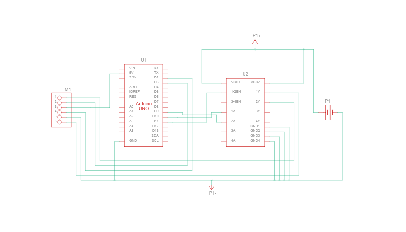
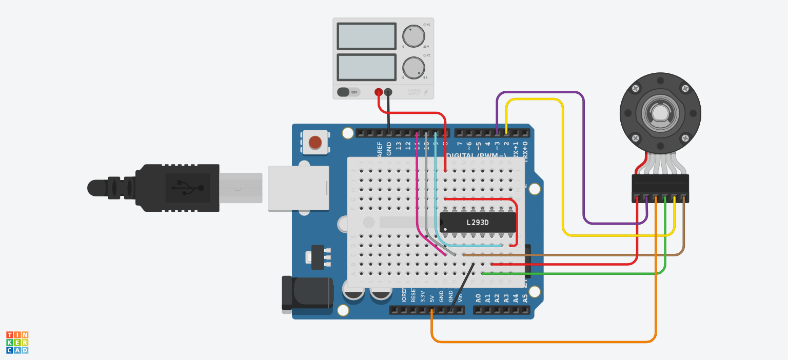

# Arduino Program

uses PID to control a motor
if you want it to do something different fork it and change the source code, i tried to make it as easy as possible

change `degrees` to change how far it turns

460 is a magic number i came up with after many iterations of putting my finger to the screen, getting the motor to turn in a circle, and correcting for undershoot/overshoot\
because sometimes you just have to know when exact is too much to ask for (i really like using exact values)

we are engineers now\
if sin x = x is good enough for small x\
then 460 is good enough for small turns 

got most code from this, also good for PIDing \
https://www.youtube.com/watch?v=dTGITLnYAY0 

their repo:
https://github.com/curiores/ArduinoTutorials/blob/main/encoderControl/part3/part3.ino

schematic:

if you can't read schematics:

